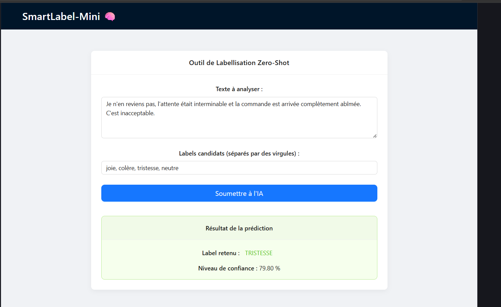

# SmartLabel-Mini — trier automatiquement un texte dans les catégories de votre choix

Ce projet sert à **ranger un texte dans une catégorie que vous choisissez vous-même** (par exemple « joie », « colère », « tristesse », « neutre »), grâce à une intelligence artificielle, sans avoir à lui apprendre ces catégories au préalable.



---

## À quoi ça sert

Trier des textes à la main prend du temps : lire chaque message client, chaque avis ou chaque document, puis décider dans quelle « case » il va.

SmartLabel-Mini fait ce tri à votre place. Vous lui donnez :

1. un **texte**, par exemple : « Je n'en reviens pas, l'attente était interminable et la commande est arrivée complètement abîmée. C'est inacceptable. » ;
2. une **liste de catégories** possibles, séparées par des virgules, par exemple : `joie, colère, tristesse, neutre`.

L'application répond avec **la catégorie la plus probable** et un **niveau de confiance** (un pourcentage qui indique à quel point l'IA est sûre de son choix).

Le point fort : **vous pouvez changer les catégories à tout moment**. Aujourd'hui des émotions, demain `livraison, facturation, panne technique` pour trier des demandes au service client. Il n'y a rien à reprogrammer.

Exemples d'usages possibles :

- repérer l'émotion ou l'humeur d'un message (satisfait, en colère, neutre…) ;
- orienter automatiquement des demandes de support client vers le bon service ;
- classer des documents ou des messages par thème.

---

## Comment ça marche

### L'idée : la classification « zero-shot »

D'habitude, pour qu'une IA range des textes dans des catégories, il faut d'abord l'**entraîner** : lui montrer des milliers d'exemples déjà triés pour chaque catégorie. Si on ajoute une catégorie, il faut recommencer.

La méthode utilisée ici s'appelle **zero-shot** (« zéro exemple ») : l'IA n'a besoin d'**aucun exemple** pour vos catégories. Elle a déjà appris, de façon générale, à juger si une phrase « va avec » une autre. Pour chaque catégorie proposée, elle se demande en quelque sorte : « Ce texte parle-t-il de *colère* ? de *joie* ? … », puis garde la catégorie qui convient le mieux.

C'est comme demander à quelqu'un qui maîtrise bien la langue de ranger des lettres dans des boîtes étiquetées : il n'a pas besoin de formation spéciale, il lit l'étiquette et le contenu, et décide.

### Les étapes

1. Vous saisissez le texte et les catégories dans la page web.
2. La page envoie ces informations au **serveur** (le programme qui tourne en arrière-plan).
3. Le serveur les transmet à un **modèle d'IA** : un programme qui a « appris » à comprendre le langage en lisant une très grande quantité de textes. Celui utilisé ici, `joeddav/xlm-roberta-large-xnli`, est **multilingue** : il comprend notamment le français et l'anglais.
4. Le modèle attribue un score à chaque catégorie. Le serveur renvoie la meilleure catégorie et son score.
5. La page affiche le résultat.

Le modèle tourne **sur votre propre machine**. Il est téléchargé une fois depuis **Hugging Face** (une plateforme qui partage des modèles d'IA) au premier lancement, puis gardé en mémoire pour les fois suivantes. Le texte analysé n'est envoyé à aucun service extérieur.

---

## Comment on s'en sert : le tri des tickets de support

L'application est pensée pour une équipe de support client qui reçoit des tickets (emails, formulaires, messages) à répartir. On y accède après une **connexion par email et mot de passe** (voir « Authentification » plus bas). Le travail se fait en trois étapes :

1. **Choisir les catégories de tri.** Un jeu est proposé (« Support client » : facturation, livraison, panne technique, compte et accès, réclamation, autre, avec les priorités urgente / normale / basse, de la plus urgente à la moins urgente). On peut le modifier, créer ses propres jeux et les **enregistrer pour toute l'équipe**.
2. **Charger les tickets.** Soit en important un **fichier CSV** (la colonne du texte est repérée par son nom : `texte`, `message`, `description`…  ; colonnes facultatives : `id`, `vip` (oui/non) et `anciennete_jours`, le nombre de jours d'attente du ticket), soit en collant les tickets, un par ligne. Maximum 500 tickets à la fois.
3. **Valider les résultats.** Pour chaque ticket, l'IA **propose** la catégorie avec un niveau de confiance, et la **priorité** est calculée par des **règles lisibles** (survolez le « i » à côté de la priorité pour voir pourquoi). Un ticket est marqué **« à relire »** si la confiance est sous le **seuil** (75 % par défaut, réglable) ou si sa priorité est la plus haute : un humain valide toujours les urgences. La personne qui trie peut corriger la catégorie ou la priorité, valider ligne par ligne ou d'un clic tous les cas sûrs, puis **exporter le résultat en CSV** (avec la proposition de l'IA, la décision finale et le statut).

Principe : **l'IA propose, l'humain décide.** Le pourcentage de confiance sert à concentrer l'attention humaine sur les cas douteux.

> La capture d'écran en haut de cette page montre l'ancienne version de l'interface (analyse d'un seul texte).

---

## Pour les développeurs

### Architecture

L'application est composée de deux services, conteneurisés avec Docker :

- **Frontend** : React 19 + Vite, avec la bibliothèque de composants Ant Design. L'API est appelée via `axios`.
- **Backend** : FastAPI (Python), servi par Uvicorn.
- **Modèle d'IA** : `joeddav/xlm-roberta-large-xnli`, chargé avec le `pipeline("zero-shot-classification")` de la bibliothèque Transformers (Hugging Face) et exécuté avec PyTorch. Le modèle est chargé une seule fois au démarrage du backend.
- **Docker / Docker Compose** : un environnement d'exécution identique sur toutes les machines. Un volume Docker (`huggingface_cache`) conserve le modèle téléchargé entre deux démarrages.

### API

| Méthode | Route | Rôle |
|---|---|---|
| `POST` | `/api/login` | Vérifie l'email et le mot de passe, renvoie un jeton de session (seule route publique) |
| `POST` | `/api/logout` | Ferme la session : le jeton est oublié côté serveur et ne vaut plus rien |
| `POST` | `/api/predict` | Classe un texte parmi les catégories fournies |
| `POST` | `/api/triage` | Propose une catégorie (moteur au choix : local, entraîné, Mistral) et une priorité (règles, avec leurs raisons) pour jusqu'à 50 tickets |
| `GET` | `/api/engines` | Moteurs de classification disponibles pour des catégories données |
| `GET` | `/api/label-sets` | Liste les jeux de catégories enregistrés |
| `PUT` | `/api/label-sets/{nom}` | Crée ou remplace un jeu de catégories (50 jeux maximum) |
| `DELETE` | `/api/label-sets/{nom}` | Supprime un jeu |

Exemple de requête :

```json
{
  "text": "Le client est vraiment furieux à cause du retard de livraison.",
  "candidate_labels": ["joie", "colère", "tristesse", "neutre"]
}
```

Format de la réponse :

```json
{
  "text": "…",
  "predicted_label": "…",
  "confidence_score": 0.0
}
```

`confidence_score` est le score de la catégorie retenue, entre 0 et 1, arrondi à 4 décimales.

La documentation interactive générée par FastAPI (`/docs`, `/redoc`, `/openapi.json`) est **fermée par défaut** : elle est accessible sans connexion et décrit tout le schéma de l'API. Pour l'ouvrir en développement, mettez `ENABLE_DOCS=1` dans votre `.env`, puis ouvrez **http://localhost:8000/docs**.

### Lancement avec Docker (recommandé)

Prérequis : [Docker Desktop](https://www.docker.com/products/docker-desktop/) installé et démarré.

#### 1. Cloner le projet

```bash
git clone https://github.com/Ramcy-cloud/smartlabel-mini.git
cd smartlabel-mini
```

#### 2. Définir la connexion

Copiez `.env.example` en `.env` **à la racine du projet** (ce fichier est ignoré par Git) et renseignez au minimum :

```
APP_EMAIL=votre.adresse@exemple.com
APP_PASSWORD=un-mot-de-passe-long-et-unique
```

Sans ces deux valeurs, personne ne peut se connecter. Les autres variables sont facultatives (voir `.env.example`).

#### 3. Construire et démarrer les conteneurs

En arrière-plan (mode « détaché ») :

```bash
docker compose up -d --build
```

Le premier lancement prend plusieurs minutes : Docker télécharge les images de base et les dépendances, puis le backend télécharge le modèle d'IA.

#### 4. Ouvrir l'interface

- Interface : **http://localhost:5175/** (le port 5175 de la machine est relié au port 8080 du conteneur)
- API : **http://localhost:8000**

Le frontend est **construit** puis servi par nginx, sous un compte sans privilège. L'adresse de l'API est figée au moment de la construction par `VITE_API_BASE_URL` (par défaut `http://127.0.0.1:8000/api`) ; `API_ORIGIN` doit désigner la même origine, car nginx n'autorise les appels réseau de la page que vers celle-ci. Les deux se règlent dans le fichier `.env` à la racine.

Sous Linux, le dossier `backend/data` monté dans le conteneur doit être accessible en écriture par l'utilisateur du conteneur (UID `10001`) : si l'enregistrement d'un jeu de catégories échoue, lancez `sudo chown -R 10001:10001 backend/data`.

#### 5. Commandes utiles

- Suivre les journaux (logs) en temps réel :

  ```bash
  docker compose logs -f
  ```

- Arrêter l'application :

  ```bash
  docker compose down
  ```

- Arrêter l'application et supprimer le cache du modèle d'IA (il sera retéléchargé au prochain lancement) :

  ```bash
  docker compose down -v
  ```

  Vos jeux de catégories et vos modèles entraînés sont dans le dossier `backend/data` de votre machine : cette commande ne les supprime pas.

### Utiliser l'application sur votre machine (sans serveur ni hébergeur)

C'est le mode actuel du projet : l'application tourne sur votre ordinateur, avec Docker, et personne d'autre n'y accède.

- **Démarrer / arrêter** : `docker compose up -d` et `docker compose down`, puis ouvrir http://localhost:5175.
- **Mettre à jour** après une nouvelle version : `git pull`, puis `docker compose up -d --build`.
- **Sauvegarder vos données** : copiez le dossier `backend/data` (jeux de catégories et modèles entraînés).
- **Donner accès à d'autres personnes** n'est pas prévu dans ce mode : il faudrait un serveur, du HTTPS et des comptes individuels (voir « Limites connues »).
- Les images publiées par la CD sur `ghcr.io` ne servent qu'à un futur hébergement : vous n'en avez pas besoin pour travailler en local.

### Lancement sans Docker

Backend (Python 3.12 ou plus récent ; l'image Docker utilise Python 3.12. Python 3.10 et 3.11 ne reçoivent plus tous les correctifs de sécurité ou arrivent en fin de vie) :

```bash
cd backend
pip install -r requirements.txt
uvicorn app.main:app --host 0.0.0.0 --port 8000
```

Frontend (Node.js et npm) :

```bash
cd frontend
npm ci
npm run dev
```

L'interface est alors disponible sur **http://localhost:5173**.

### Priorité : des règles, pas de l'IA

Un modèle zero-shot devine mal une priorité à partir d'un seul mot comme « urgente » (il a classé en « basse » une double facturation). La priorité est donc calculée par des règles explicites (`backend/app/services/priority.py`), et chaque résultat indique ses raisons :

1. **Signaux d'urgence** dans le texte (français et anglais, sans tenir compte de la casse ni des accents) : urgent, bloqué, hors service, « ne fonctionne plus », perte de ventes ou de données, double prélèvement, fraude, piratage, avocat, mise en demeure, plainte, résiliation, « depuis trois semaines »… Un mot nié (« pas urgent », « mon compte n'est pas bloqué ») ne compte pas.
2. **Signaux de faible urgence** (« sans urgence », « pour information », « simple question », « suggestion »…), pris en compte seulement s'il n'y a aucun signal d'urgence.
3. **Rien de particulier** : priorité du milieu de la liste (« normale »).
4. **Montées d'un cran** : client `vip`, ou ticket en attente depuis 7 jours ou plus (`anciennete_jours`).
5. **Priorité minimale par catégorie** (réglable dans l'interface) : par exemple, une réclamation n'est jamais « basse ».
6. **Mots-clés propres à votre activité**, ajoutables par jeu de catégories.

La première priorité de la liste est la plus urgente, la dernière la moins urgente. Ces règles sont simples : elles ne comprennent pas le sens d'une phrase (une ironie, une négation lointaine). Testez-les sur vos tickets et ajoutez vos mots-clés.

### Fiabilité de la catégorie : trois moteurs, deux outils

La catégorie est le point faible d'un modèle « zero-shot » (il n'a jamais vu vos tickets). Trois moteurs sont proposés dans l'interface, et deux outils permettent de mesurer et d'améliorer la qualité.

**Les moteurs** (choisis dans la carte « Tickets à trier »)

| Moteur | Où ça tourne | Quand l'utiliser |
|---|---|---|
| **Local (zero-shot)** | votre machine | Par défaut. Ne demande aucune donnée d'entraînement. |
| **Entraîné sur vos tickets** | votre machine | Dès que vous avez quelques centaines de tickets validés. Le plus fiable sur *vos* catégories. |
| **Mistral (cloud)** | service externe | Optionnel, désactivé tant qu'aucune clé n'est configurée. **Les tickets quittent votre machine.** |

**1. Décrire les catégories.** Dans « Catégories de tri », une phrase par catégorie (« problème de facture, de paiement, de prélèvement ou de remboursement ») aide le modèle à comprendre ce qu'elle recouvre. Le modèle local teste aussi chaque catégorie avec une phrase en français (`HYPOTHESIS_TEMPLATE`, par défaut « Ce texte concerne : {}. ») au lieu de la phrase anglaise d'origine.

**2. Mesurer avant de faire confiance.** Préparez un CSV de vrais tickets avec leur bonne catégorie (colonnes `texte` et `categorie`, et si vous voulez `priorite`, `vip`, `anciennete_jours`), puis :

```bash
cd backend
python -m tools.evaluate mes_tickets.csv --set "Support client"
```

L'outil affiche l'exactitude globale, la précision et le rappel de chaque catégorie, la matrice de confusion (quelles catégories se confondent), l'exactitude par niveau de confiance et le **seuil de relecture conseillé** pour atteindre la précision visée (`--target 0.9`). Sans ce chiffre, le seuil de 75 % de l'interface n'est qu'un réglage au hasard. Options utiles : `--engine trained|mistral`, `--errors erreurs.csv`, `--no-descriptions`, `--template "..."`.

Un jeu d'**exemple synthétique** de 144 tickets est fourni dans `backend/tools/exemples/tickets_exemple.csv` pour essayer l'outil. Il a été écrit à la main : il ne représente pas vos vrais tickets et ne dit rien de la qualité réelle sur vos données.

**3. Apprendre de vos corrections.** Chaque export CSV garde la proposition de l'IA, votre décision finale et le statut. Les tickets « validé » ou « corrigé » ont été relus par un humain : ils servent à entraîner un classifieur sur vos propres données.

```bash
cd backend
pip install -r requirements-tools.txt
python -m tools.train export_tickets.csv --set "Support client"
```

L'outil n'utilise que les tickets validés (20 minimum, 2 catégories au moins), mesure l'exactitude en validation croisée et enregistre le modèle en JSON dans `backend/data/models`. Le moteur « Entraîné sur vos tickets » apparaît alors, pour exactement ces catégories. Pour une mesure honnête, évaluez-le sur **d'autres** tickets que ceux de l'entraînement. Réentraînez de temps en temps avec les nouvelles corrections. Le modèle est un fichier JSON, jamais du code exécutable : un fichier modifié ou piégé est simplement refusé.

**4. Mistral (optionnel).** Pour l'activer, ajoutez `MISTRAL_API_KEY` dans `backend/.env` (ou dans le `.env` racine avec Docker), puis redémarrez le backend. Précautions intégrées : une confirmation est demandée dans l'interface avant chaque envoi ; les emails, téléphones, IBAN, numéros de carte et liens sont masqués avant l'envoi (mais pas les noms ni les adresses, vérifiez que votre usage est autorisé) ; le ticket est présenté au modèle comme une donnée à classer, jamais comme une instruction ; la réponse doit être le numéro d'une catégorie de la liste, sinon le ticket est laissé « en erreur » pour traitement manuel ; la clé n'apparaît jamais dans les journaux ni dans les réponses de l'API. La confiance annoncée par Mistral est une estimation du modèle lui-même : mesurez-la avec `tools.evaluate` avant de vous y fier.

**Ce que donnent ces réglages (mesures sur le jeu d'exemple synthétique)**

Ces chiffres viennent des 144 tickets d'exemple, écrits à la main. Ils montrent l'effet des réglages, pas la qualité sur vos tickets : avec si peu de tickets, un écart de quelques points est dans le bruit de la mesure.

Modèle local, 144 tickets :

| Réglage | Exactitude | F1 moyen | À 75 % de confiance : tickets sans relecture / bonnes réponses |
|---|---|---|---|
| Noms de catégories, phrase anglaise (réglage d'origine) | 53,5 % | 49,1 % | 25 % / 67 % |
| Noms de catégories, phrase française | 61,1 % | 59,6 % | 33 % / 85 % |
| Descriptions, phrase anglaise | 50,0 % | 49,6 % | 29 % / 100 % |
| **Descriptions, phrase française (réglage par défaut)** | 59,0 % | 60,8 % | 21 % / 100 % |

La phrase en français gagne 6 à 9 points d'exactitude. Les descriptions coûtent environ 2 points d'exactitude mais rendent la confiance bien plus fiable : à 75 %, toutes les réponses étaient justes (contre 85 % sans description). C'est ce qui compte pour décider quoi relire, d'où le choix par défaut.

Moteur entraîné, avec 96 tickets d'entraînement (16 par catégorie), mesuré sur 48 autres tickets jamais vus :

| Moteur | Exactitude | À 75 % de confiance : tickets sans relecture / bonnes réponses |
|---|---|---|
| Local (zero-shot) | 62,5 % | 15 % / 100 % |
| **Entraîné sur 96 tickets** | 81,2 % | 67 % / 91 % |

Avec très peu d'exemples, le moteur entraîné est déjà nettement plus juste, et il laisse passer bien plus de tickets sans relecture. Sur de vrais tickets, avec des centaines d'exemples par catégorie, l'écart devrait se creuser, mais **seule la mesure sur vos données fait foi** (`tools.evaluate`). Attention : ces tickets d'exemple suivent des formulations proches les unes des autres, ce qui avantage un moteur entraîné par rapport à de vrais tickets plus variés.

### Authentification

L'application est protégée par un compte partagé par l'équipe (même principe que le projet RAG PDF).

1. Définissez `APP_EMAIL` et `APP_PASSWORD` : dans un fichier `.env` à la racine pour Docker, ou dans `backend/.env` sans Docker (modèle dans `.env.example`). **Si l'une des deux est vide, personne ne peut se connecter.** Choisissez un mot de passe long et unique ; ne le mettez jamais dans le code ni dans un fichier suivi par Git.
2. `POST /api/login` vérifie les identifiants (comparaison à temps constant, adresse email insensible à la casse) et renvoie **un jeton propre à cette connexion** (256 bits aléatoires), accompagné de sa durée de validité (`expires_in`). Après 5 échecs depuis une même adresse IP, les connexions sont refusées pendant une minute.
3. Toutes les autres routes `/api` exigent l'en-tête `Authorization: Bearer <jeton>` (`401` sinon). Le navigateur garde le jeton le temps de l'onglet (`sessionStorage`), jamais dans l'URL.
4. Un jeton cesse d'être accepté dans trois cas : au bout de `SESSION_TTL_HOURS` (12 h par défaut, ramené entre 1 et 168), à la **déconnexion** (`POST /api/logout` l'oublie côté serveur, donc un jeton intercepté ne sert plus à rien) et au redémarrage du backend. Le nombre de sessions vivantes est plafonné à 50 : au-delà, la plus ancienne est oubliée.

Limites : un seul compte partagé, pas de rôles ni de journal des actions. Servez toujours l'application en **HTTPS** hors de votre machine : sans cela, mot de passe et jeton circulent en clair.

### Sécurité de l'API

- **Limites :** requête de 1 Mo maximum (`413` au-delà), 50 tickets de 5 000 caractères par requête, 20 libellés de 100 caractères par jeu, et les mêmes limites sur `/api/predict` : le modèle évalue le texte une fois par libellé, donc sans plafond un seul appel suffit à saturer le serveur. Les routes d'IA sont limitées par adresse IP (`RATE_LIMIT_PER_MINUTE`, 60 par défaut, `429` au-delà). Une seule prédiction est calculée à la fois, sur les deux routes : les autres requêtes patientent.
- **Taille annoncée :** un corps envoyé « en morceaux » (`Transfer-Encoding: chunked`) n'annonce pas sa taille et serait donc lu en entier avant toute vérification. `POST`, `PUT` et `PATCH` exigent un `Content-Length` exploitable (`411` sinon).
- **Documentation fermée :** `/docs`, `/redoc` et `/openapi.json` ne sont servis que si `ENABLE_DOCS` le demande : ces pages sont publiques par nature et décrivent toute l'API.
- **Hôtes acceptés :** `ALLOWED_HOSTS` (noms séparés par des virgules ; par défaut `localhost,127.0.0.1`). À renseigner avec le nom de domaine réel en déploiement.
- **En-têtes :** `X-Content-Type-Options`, `X-Frame-Options`, `Referrer-Policy`, `Content-Security-Policy` (`default-src 'none'` : une réponse d'API n'a besoin d'aucune ressource externe) et `Cache-Control: no-store` sur l'API. nginx pose ses propres en-têtes sur la page et ses scripts (voir `frontend/nginx.conf.template`). Ajoutez `Strict-Transport-Security` et le HTTPS sur le serveur frontal (proxy) en production.
- **Mémoire bornée :** les compteurs par adresse IP (débit, tentatives de connexion) et le cache des modèles entraînés oublient les entrées inactives et sont plafonnés : un trafic venu de milliers d'adresses ne fait pas grossir la mémoire du serveur sans fin.
- **Conteneurs sans privilège :** les deux images tournent sous un utilisateur dédié, jamais `root`. Le frontend est servi en version construite par nginx, et non par le serveur de développement de Vite, qui sert les sources et n'est pas fait pour être exposé.
- **Dépendances :** `backend/requirements.txt` fixe une version minimale par paquet, avec la faille qu'elle corrige en commentaire. À vérifier avant chaque mise à jour : `pip-audit -r requirements.txt` et `npm audit` dans `frontend/`.
- **Données :** les textes des tickets ne sont ni enregistrés ni écrits dans les journaux. Seuls les jeux de catégories sont conservés, dans `backend/data/label_sets.json` (variable `LABEL_SETS_PATH`), avec les modèles entraînés dans `backend/data/models` ; avec Docker, ce dossier de votre machine est monté dans le conteneur. Un fichier corrompu est mis de côté en `.corrompu` au lieu d'être écrasé.
- **Export CSV :** les cellules qui commencent par `=`, `+`, `-` ou `@` sont neutralisées pour éviter l'exécution de formules dans Excel (« CSV injection »).
- **Un seul processus :** le verrou des jeux enregistrés et la limitation de débit sont en mémoire ; lancez Uvicorn avec un seul worker.

### Configuration : origines autorisées (CORS)

Par sécurité, le navigateur n'autorise une page web à interroger l'API que si l'adresse de cette page figure dans la liste des **origines autorisées**. Cette liste se règle avec la variable d'environnement `ALLOWED_ORIGINS` : des adresses séparées par des virgules, les espaces sont ignorés.

- **Valeur par défaut** (variable absente) : `http://localhost:5175,http://localhost:5173`, c'est-à-dire l'interface lancée avec Docker et celle lancée avec `npm run dev`. Le fonctionnement local ne change donc pas.
- **Exemple pour un déploiement** : `ALLOWED_ORIGINS=https://app.example.com,https://admin.example.com`
- `*` (« tout le monde ») est **refusé** : le backend ne démarre pas si cette valeur est présente.
- Avec Docker, `docker-compose.yml` transmet la variable au backend ; vous pouvez la définir dans un fichier `.env` placé à la racine (voir `.env.example`). Sans Docker, définissez-la avant `uvicorn`, par exemple `ALLOWED_ORIGINS=https://app.example.com uvicorn app.main:app` (Linux/macOS).
- Seules les méthodes `GET`, `POST`, `PUT`, `DELETE` et les en-têtes `Content-Type` et `Authorization` sont autorisés. Il n'y a pas de cookies, donc pas de credentials CORS.

### Tests du backend

```bash
cd backend
pip install -r requirements-dev.txt
python -m pytest
```

205 tests couvrent le tri et les priorités, les trois moteurs, les outils de mesure et d'entraînement, la configuration CORS, l'authentification, le cycle de vie des sessions et les protections de l'API (limites de taille et de débit, documentation fermée, bornes mémoire). Le vrai modèle d'IA n'est pas chargé : il est remplacé par un faux (`tests/conftest.py`), donc rien n'est téléchargé.

Côté frontend : `npm run lint` et `npm run build`. Pour les failles connues des dépendances : `npm audit` dans `frontend/`, et `pip install pip-audit && pip-audit -r requirements.txt` dans `backend/`.

### CI/CD

Les workflows s'appuient sur les modèles partagés de [`Ramcy-cloud/ci-templates`](https://github.com/Ramcy-cloud/ci-templates) (version `v1`).

- **CI** (`.github/workflows/ci.yml`) — à chaque pull request et à chaque push sur `main` : tests du backend (`pytest`, sans charger le vrai modèle), lint et build du frontend, construction des images Docker sans publication.
- **CD** (`.github/workflows/cd.yml`) — quand la CI est verte sur `main`, une livraison démarre puis **attend une validation manuelle** (environnement GitHub `production`). Pour livrer : onglet *Actions* → exécution *CD* → **Review deployments** → cocher `production` → **Approve and deploy**. Les images sont alors publiées sur `ghcr.io/ramcy-cloud/smartlabel-mini/backend` et `.../frontend` (tags `latest` et SHA du commit).
- Aucun secret n'est nécessaire : le token `GITHUB_TOKEN` fourni par GitHub Actions suffit pour publier sur ghcr.io.

### Structure du projet

```
smartlabel-mini/
├── backend/
│   ├── Dockerfile
│   ├── requirements.txt          # Versions minimales (failles connues en commentaire)
│   ├── requirements-dev.txt      # Dépendances de test (pytest)
│   ├── requirements-tools.txt    # Dépendances des outils de mesure et d'entraînement
│   ├── tests/                    # Tests (CORS, triage, sécurité, sessions, moteurs, Mistral, outils)
│   ├── tools/                    # evaluate.py (mesure), train.py (entraînement), exemples/
│   └── app/
│       ├── main.py               # Application FastAPI, CORS (ALLOWED_ORIGINS), préfixe /api
│       ├── auth.py               # Connexion, sessions (durée, révocation), anti brute-force
│       ├── security.py           # Limites de taille et de débit, en-têtes, hôtes
│       ├── api/routes.py         # Routes /predict, /triage, /label-sets
│       ├── models/schemas.py     # Formats de requête et de réponse (Pydantic)
│       └── services/
│           ├── ai_service.py     # Chargement du modèle zero-shot et prédiction
│           ├── classifiers.py    # Moteurs de classification (choix, disponibilité)
│           ├── trained_engine.py # Moteur entraîné sur vos tickets (modèle JSON)
│           ├── mistral_engine.py # Moteur Mistral optionnel (cloud)
│           ├── redaction.py      # Masquage des données personnelles avant envoi à Mistral
│           ├── priority.py       # Priorité par règles explicites
│           └── label_sets.py     # Jeux de catégories enregistrés
├── frontend/
│   ├── Dockerfile                # Construction puis nginx sans privilège (pas le serveur Vite)
│   ├── nginx.conf.template       # En-têtes de sécurité et cache des fichiers servis
│   ├── package.json
│   ├── index.html
│   ├── vite.config.js
│   ├── public/                   # Icônes
│   └── src/
│       ├── App.jsx               # Page principale (catégories, tickets, résultats)
│       ├── components/           # Connexion, catégories, moteur, saisie des tickets, tableau de résultats
│       ├── csv.js                # Lecture et export CSV
│       ├── triage.js             # Règles de statut (à relire, corrigé…)
│       ├── services/api.js       # Appel à l'API
│       └── *.css                 # Styles
├── docker-compose.yml
├── .env.example                  # Variables d'environnement (connexion, CORS, sessions, Mistral…)
├── docs/demo.png                 # Capture d'écran
└── README.md
```

### Limites connues

- Authentification minimale : un seul compte partagé, pas de rôles ni de journal des actions (voir « Authentification »). Pour un usage multi-utilisateurs, prévoyez des comptes individuels, ou un fournisseur d'identité de l'entreprise (SSO).
- Pas de traitement en arrière-plan : l'analyse se fait par lots de 10 tickets, page ouverte (environ une à deux secondes par ticket sur processeur). Fermer la page interrompt l'analyse.
- Les jeux de catégories sont partagés par toutes les personnes connectées (pas de droits par utilisateur).
- La qualité de la catégorie dépend du moteur et de vos données : le modèle local n'a jamais vu vos tickets, le moteur entraîné a besoin de tickets validés, et Mistral envoie les textes à l'extérieur. Mesurez toujours avec `tools.evaluate` sur de vrais tickets avant tout usage réel (voir « Fiabilité de la catégorie »).
- Les priorités viennent de règles simples : elles ne comprennent pas le sens d'une phrase.
- Les sessions sont gardées en mémoire du processus : avec plusieurs workers Uvicorn, un jeton émis par l'un serait refusé par les autres. Lancez un seul worker (voir « Sécurité de l'API »).

---

*Projet développé par Ramcy-cloud.*
